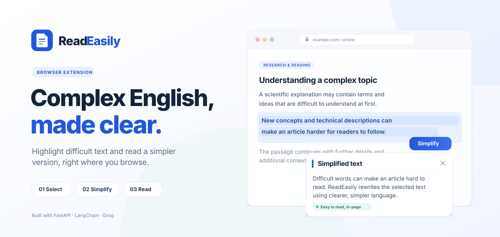

  

<h1 align="center">ReadEasily</h1>

  <strong>Complex English, made clear.</strong> 
  Simplify difficult text on webpages without copying it or switching tabs.

  <code>Chrome Extension · Manifest V3</code> &nbsp;·&nbsp;
  <code>Python</code> &nbsp;·&nbsp;
  <code>FastAPI</code> &nbsp;·&nbsp;
  <code>LangChain</code> &nbsp;·&nbsp;
  <code>Groq</code>

---

## What is ReadEasily?

ReadEasily is a Chrome extension that helps make dense English easier to understand. Highlight a passage on a webpage, click **Simplify**, and read an AI generated plain English version in a small, scrollable panel beside the page.

It can help with academic articles, technical documentation, news, Wikipedia pages, and other difficult English writing. No copy pasting into another tab is required.

## Why ReadEasily?

When you come across difficult English online, getting a simpler explanation often means copying the text, opening an AI assistant like ChatGPT or Gemini, writing a prompt, and switching back to what you were reading. That interrupts your focus and slows you down.

**ReadEasily brings that step into your browser.** Highlight any passage, click **Simplify**, and see a plain English rewrite in a floating panel beside the page. no copy pasting, prompt writing, or tab switching required.

<video src="https://github.com/ibrahimbhatti-source/ReadEasily/blob/main/ReadEasily-Demo.mp4" controls width="100%"></video>

<strong>ReadEasily</strong> — Understand more. Read with ease.

